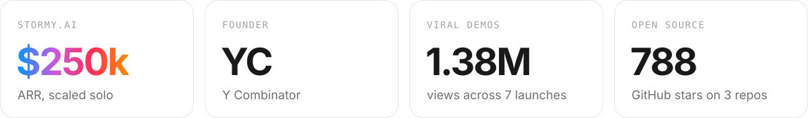
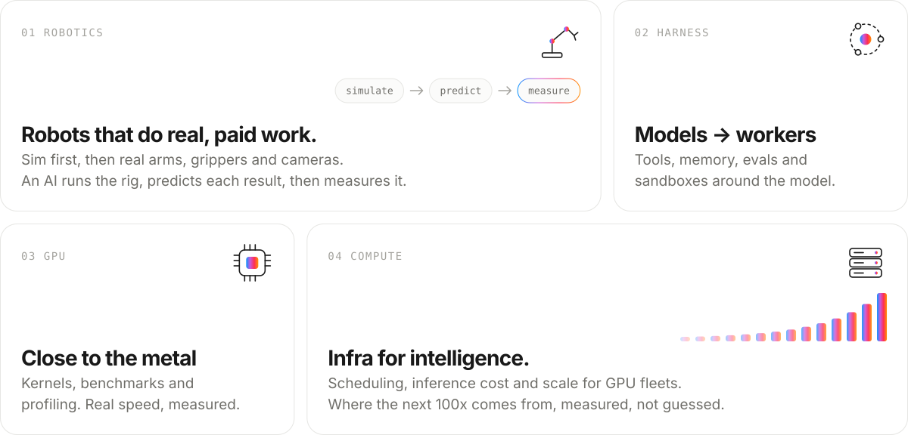

<picture>
  <source media="(prefers-color-scheme: dark)" srcset="assets/hero-dark.svg">
  
</picture>

<picture>
  <source media="(prefers-color-scheme: dark)" srcset="assets/stats-dark.svg">
  
</picture>

### What I work on now

<picture>
  <source media="(prefers-color-scheme: dark)" srcset="assets/focus-dark.svg">
  
</picture>

### The proof

**[stormy.ai](https://stormy.ai)** is AI for businesses that run on jobs. It answers calls and texts, dispatches crews, and sends quotes and invoices.
I built it and scaled it to **$250k ARR, solo**, as a YC founder.

Building it showed me where AI really breaks: in the harness around the model and in the compute under it.
That is what I research now, all the way down to GPUs and out to robots.

### Demos that went viral · 1.38M views

| When | What I shipped | Views |
|:--|:--|--:|
| Dec 2025 | [AI that watches your PostHog session replays](https://x.com/Karmedge/status/2000619863845552212) | **126k** |
| Mar 2025 | [MCP server for LinkedIn](https://x.com/Karmedge/status/1897392194572705988) | **250k** |
| Dec 2024 | [AI TeamViewer for macOS](https://x.com/Karmedge/status/1873052138093592781) | **70k** |
| Aug 2024 | [AI that keeps you focused on macOS](https://x.com/Karmedge/status/1820915009712431128) | **250k** |
| May 2024 | [Index everything you see on screen, then ask a local AI](https://x.com/Karmedge/status/1790386735295218130) | **160k** |
| Feb 2024 | AI characters that live on your Mac and know what you do: [part 1](https://x.com/Karmedge/status/1753540355440427453), [part 2](https://x.com/Karmedge/status/1774728840058634697) | **150k** |
| Nov 2023 | [AI that sees through your webcam and narrates your life](https://x.com/Karmedge/status/1720825128177578434) | **375k** |

### Open source

| Repo | What it does | Stars |
|:--|:--|--:|
| [realtime-bakllava](https://github.com/OneInterface/realtime-bakllava) | llama.cpp + BakLLaVA describe your webcam in real time | **378** |
| [client-vector-search](https://github.com/yusufhilmi/client-vector-search) | Embed, store and search vectors in the browser, no server | **229** |
| [chat-with-page](https://github.com/OneInterface/chat-with-page) | Chat with any web page through a local LLM | **181** |

### Say hi

<a href="https://x.com/Karmedge"><picture><source media="(prefers-color-scheme: dark)" srcset="assets/link-x-dark.svg"></picture></a>
<a href="https://www.linkedin.com/in/karmedge"><picture><source media="(prefers-color-scheme: dark)" srcset="assets/link-linkedin-dark.svg"></picture></a>
<a href="https://t.me/robertlu"><picture><source media="(prefers-color-scheme: dark)" srcset="assets/link-telegram-dark.svg"></picture></a>
<a href="https://stormy.ai"><picture><source media="(prefers-color-scheme: dark)" srcset="assets/link-stormy-dark.svg"></picture></a>
